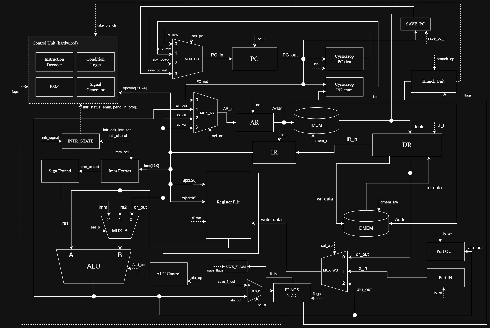
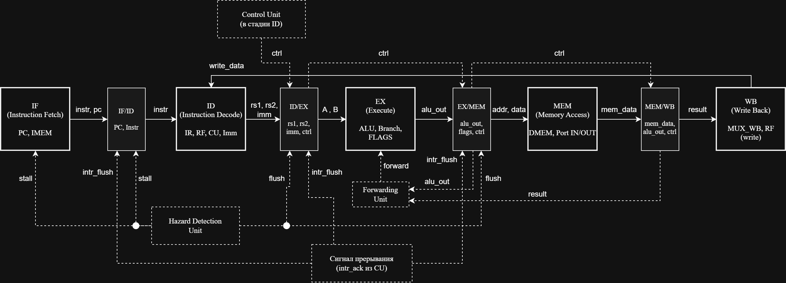

# Лабораторная работа №4

- **ФИО:** Звонков Дмитрий Игоревич
- **Группа:** P3212
- **Вариант:** `lisp | cisc | harv | hw | trap | port | cstr | pipeline | alg1`
  - `lisp` — синтаксис Lisp, S-выражения. Поддерживаются рекурсивные функции; любая форма возвращает значение; сложные выражения отображаются на регистры `R0`/`R1` и стек.
  - `cisc` — CISC-система команд: инструкция переменной длины `POLY`, косвенная адресация `LD_IND`/`ST_IND`, специальные регистры, составные операции `PUSH`/`POP`/`CALL`/`RET`.
  - `harv` — гарвардская архитектура: раздельные память команд (IMEM) и память данных (DMEM).
  - `hw` — hardwired Control Unit: FSM из пяти состояний, без микрокода. Модель исполняется по тактам, состояние доступно после каждого такта.
  - `trap` — ввод через прерывания по расписанию; обработчик пишется на Lisp; поддерживаются вложенные прерывания.
  - `port` — port-mapped I/O: порт `0` — вход, порт `1` — выход; доступ инструкциями `IN`/`OUT`.
  - `cstr` — строки с завершающим `\0`; статические строки лежат в DMEM; функции обработки строк написаны на Lisp.
  - `pipeline` — пятистадийный конвейер `IF | ID | EX | MEM | WB` с forwarding, обнаружением load-use hazard и точными прерываниями.
  - `alg1` — алгоритмы `is_prime` и `format_string`.

## Язык программирования

### Синтаксис (BNF)

```ebnf
<program>           ::= <top-level-form>*

<top-level-form>    ::= <defun> | <interrupt-handler> | <expr>

<defun>             ::= "(" "defun" <symbol> "(" <symbol>* ")" <expr>* ")"
<interrupt-handler> ::= "(" "interrupt-handler" <symbol> <integer> ")"

<expr>              ::= <atom> | "(" <expr>* ")"
<atom>              ::= <integer> | <string> | <symbol>

<integer>           ::= "-"? <digit>+
<string>            ::= '"' <string-char>* '"'
<symbol>            ::= <symbol-char>+
<symbol-char>       ::= <letter> | <digit> | "_" | "-" | "?" | "+" | "*" | "/" | "%" | "=" | "<" | ">" | "!"

<letter>            ::= "A" | ... | "Z" | "a" | ... | "z"
<digit>             ::= "0" | ... | "9"
<string-char>       ::= любой печатный ASCII, кроме '"' и "\"
```

Комментарии начинаются с `;` и продолжаются до конца строки. В строках поддерживаются escape-последовательности `\n`, `\t`, `\r`, `\"`, `\\`.

Специальные формы распознаются по первому элементу списка; остальные списки — вызовы функций. Пустой список `()` вычисляется как `0`.

### Формы языка

Все формы возвращают значение; отдельных statement-ов нет.

**Специальные формы** (вычисляют аргументы выборочно):

| Форма | Семантика | Возвращает |
|---|---|---|
| `(setq sym expr)` | присвоить `expr` переменной `sym` | новое значение |
| `(if cond then)` | если `cond ≠ 0` — `then`, иначе `0` | значение ветви |
| `(if cond then else)` | если `cond ≠ 0` — `then`, иначе `else` | значение ветви |
| `(do e1 e2 ... en)` | вычислить по порядку | значение `en`, для пустого `do` — `0` |
| `(while cond body...)` | пока `cond ≠ 0` — выполнять `body...` | `0` |
| `(and e1 e2 ...)` | короткое замыкание: до первого `0`; для пустого `and` — `1` | последнее значение или `0` |
| `(or e1 e2 ...)` | короткое замыкание: до первого `≠ 0`; для пустого `or` — `0` | первое `≠ 0` или `0` |
| `(defun name (p1 ... pn) body...)` | определить функцию | имя функции |
| `(buf n)` | статически выделить `n` слов в DMEM | адрес буфера |
| `(interrupt-handler name vec)` | зарегистрировать обработчик вектора `vec` | имя |
| `(poly c0 (c1 x1) ...)` | вычислить многочлен одной инструкцией | значение |

**Встроенные функции** (вычисляют все аргументы):

| Форма | Семантика |
|---|---|
| `(+ a b ...)`, `(* a b ...)` | сумма/произведение, не менее двух аргументов |
| `(- a b ...)`, `(/ a b ...)`, `(% a b ...)` | разность/деление/остаток, усечение к нулю |
| `(adc a b)`, `(sbc a b)` | сложение/вычитание с флагом переноса `C` |
| `(= a b)`, `(< a b)`, `(> a b)`, `(<= a b)`, `(>= a b)`, `(/= a b)` | `1` или `0` |
| `(not e)` | `1`, если `e = 0`, иначе `0` |
| `(in port)` | прочитать слово из порта `port` (в текущей реализации — порт `0`); `-1`, если данных нет |
| `(out port val)` | записать `val` в выходной порт (в текущей реализации — порт `1`) |
| `(mem-get addr)` | прочитать слово из DMEM по байтовому адресу |
| `(mem-set addr val)` | записать слово в DMEM по байтовому адресу |
| `(ei)`, `(di)`, `(iret)` | разрешить/запретить прерывания, вернуться из обработчика |

**Стандартная библиотека** (`lib/stdlib.lisp`, транслируется вместе с программой):

| Функция | Семантика |
|---|---|
| `(getc)` | следующий символ ввода; `-1` при EOF (busy-wait + trap) |
| `(read-char)` | синоним `getc` |
| `(print-char c)` | вывести символ в порт 1 |
| `(print-str s)` | вывести cstr по адресу `s` |
| `(print-int n)` | вывести `n` в десятичном виде (рекурсивно) |
| `(read-line-limited buf max)` | прочитать строку до `\n`; `-1` при переполнении |
| `(read-int-line)` | прочитать строгое 32-битное целое из строки |
| `(str-len s)` | длина cstr |
| `(char-at s i)` | `s[i]` или `-1` за `\0`; адрес — `s + 4*i` |
| `(char-set s i c)` | записать `c` в `s[i]` |
| `(scan-width s i)` | разобрать ширину поля формата |
| `(int-len n)` | число десятичных цифр `|n|` |
| `(write-int n out pos)` | записать число в буфер, вернуть позицию |
| `(write-padded n out pos spec)` | записать число с шириной; `spec < 0` — влево |

Определения пользователя перекрывают одноимённые функции stdlib: `merge_programs` удаляет из библиотеки `defun` с тем же именем. Строковые операции вынесены в библиотеку, а не в ISA — требование варианта `cstr`.

### Семантика

**Стратегия вычислений** — строгая, слева направо. Аргументы вычисляются до применения формы. Исключение — специальные формы `if`, `and`, `or`, `while`, `do`, `setq`, `defun`, `buf`, `interrupt-handler`, `poly`: они вычисляют аргументы выборочно. В частности, `if` не вычисляет невыбранную ветвь, `and`/`or` замыкаются на первом определяющем значении.

**Области видимости** — глобальная. `defun` и `setq` создают глобальные сущности. Параметры функции — лексические: видны только внутри тела и затеняют глобальные с тем же именем. Параметры можно изменять через `setq` (локальная мутация параметра). Замыканий нет, вложенных `defun` нет.

Все `defun` собираются на этапе трансляции; top-level формы, не являющиеся `defun`/`interrupt-handler`, выполняются по порядку сверху вниз.

**Типизация** — слабая, динамическая. Единственный тип значения — 32-битное целое со знаком. Строки — это адреса в DMEM (cstr). Логические значения: `0` — ложь, любое ненулевое — истина. Проверки типов нет: `(+ "abc" 1)` скомпилируется, но результат не определён.

**Литералы:**

- целые `42`, `-17` — непосредственная адресация, если помещаются в 20-битное знаковое поле; иначе размещаются в DMEM и загружаются через `LD`;
- строки `"..."` — всегда в DMEM как cstr с завершающим `\0`; выражение возвращает адрес строки;
- списки `(poly ...)` — операнды инструкции переменной длины.

**Любая форма — выражение.** Это видно в golden-тестах: в `format_string` форма `if` стоит в позиции аргумента `write-padded`, в `poly_demo` — `(print-int (poly ...))`, в `is_prime` — `(print-int (is-prime ...))`, в `double_precision` — `(setq s_lo (adc ...))`. Формы `setq`, `if`, `do`, `while`, `and`, `or` оставляют результат в `R0`, поэтому их можно вкладывать друг в друга.

### Отображение выражений на регистры и память

Вычисление идёт в `R0`; `R1` используется как временный регистр, а вложенные операнды сохраняются на стеке. Например, `(+ a (* b c))` транслируется так:

```text
LD    R0, [a]        ; R0 = a
PUSH  R0             ; сохранить a
LD    R0, [b]        ; R0 = b
PUSH  R0             ; сохранить b
LD    R0, [c]        ; R0 = c
MOV   R1, R0
POP   R0             ; R0 = b
MUL   R0, R1         ; R0 = b * c
MOV   R1, R0
POP   R0             ; R0 = a
ADD   R0, R1         ; R0 = a + b * c
```

Переменные не отображаются на регистры: все они статические и лежат в DMEM. Регистры `R0..R3` — временные; при нехватке регистров промежуточные значения уходят на стек. Это снимает проблему распределения регистров, но увеличивает число обращений к памяти.

### Соглашение о вызовах

- Не более **4 параметров** у функции: параметры передаются через `R0..R3`. Транслятор бросает `SyntaxError` при большем числе.
- Параметры хранятся в статических ячейках DMEM с именами `<функция>$<параметр>`. Перед вызовом старые значения этих ячеек кладутся на стек, после возврата — восстанавливаются, поэтому рекурсия работает.
- Результат функции возвращается в `R0`.
- Аргументы вычисляются слева направо и кладутся на стек; затем загружаются в регистры и сохраняются в параметры.
- Обработчик прерывания сохраняет `R0..R3` на стеке и завершается `IRET`.

### Точка входа

Транслятор сначала размещает все `defun` (включая stdlib), затем запоминает `entry = here()` и транслирует top-level формы. В конец добавляется `HALT`. Заголовок бинарника содержит `entry`, поэтому точка входа не обязана быть равна `0x0008`.

## Организация памяти

### Модель памяти

| Параметр | Значение |
|---|---|
| Машинное слово | 32 бита (4 байта) |
| IMEM | память команд; адрес в J-формате — 24 бита, до 16 МиБ |
| DMEM | 2^20 байт = 1 МиБ, статические данные начинаются с `0x0100` |
| Адресация | байтовая; все обращения к памяти словные и выровнены на 4 |
| Порт | однопортовый: одно чтение или одна запись за такт |
| Стек | в DMEM, растёт вниз от `0x100000` по 4 байта |

Архитектура — **гарвардская**: IMEM и DMEM имеют раздельные адресные пространства. Программист на Lisp работает с переменными, буферами, стеком и портами; регистры `R0..R3`, `PC`, `IR`, `AR`, `DR`, `SP`, `FLAGS` — уровень ISA.

### Карта IMEM

```text
       IMEM (память команд, байтовые адреса)
+------------------------------------------------------+
| 0x000000 : вектор прерывания 0 (адрес обработчика)   |
| 0x000004 : зарезервирован                            |
| 0x000008 : код функций (stdlib, затем defun программы)|
|    ...   : тела функций, обработчиков                |
| entry    : первая top-level форма программы          |
|    ...   : код верхнего уровня                       |
|    ...   : HALT                                      |
+------------------------------------------------------+
```

Вектор 0 хранит байтовый адрес обработчика. Транслятор записывает его в слово 0 IMEM; модель при приёме прерывания загружает это значение в `PC`. Слово 1 зарезервировано.

### Карта DMEM

```text
       DMEM (память данных, байтовые адреса)
+------------------------------------------------------+
| 0x000000 : не используется (порты — отдельное пр-во) |
| 0x000100 : статические данные:                       |
|            буферы stdlib, переменные, параметры,     |
|            строковые литералы, целые литералы,       |
|            буферы программы                          |
|    ...   : (свободно)                                |
| 0x0FFFFC : вершина стека (первый PUSH)               |
| 0x100000 : дно стека (SP стартует здесь)             |
+------------------------------------------------------+
```

Порядок статических данных — по первому использованию при обходе `defun` (сначала stdlib, затем программа), после чего добавляются top-level формы. Строки, переменные, параметры, литералы и буферы занимают по одному слову на элемент; строки — последовательность слов, по одному символу в младшем байте, с завершающим `0`.

Порты `IN`/`OUT` — **отдельное адресное пространство** (port-mapped), не отображены в DMEM. Доступ — только инструкциями `IN`/`OUT`.

### Размещение сущностей

| Сущность | Где | Когда |
|---|---|---|
| Инструкции | IMEM | трансляция |
| Вектор прерывания 0 | слово 0 IMEM (`0x0000`) | трансляция |
| Обработчик прерывания | IMEM | трансляция |
| Строковые литералы (cstr) | DMEM | трансляция |
| Глобальные переменные | DMEM | трансляция |
| Параметры функций | DMEM (`<func>$<param>`) | трансляция |
| Целые литералы вне immediate | DMEM | трансляция |
| Буферы `(buf N)` | DMEM | трансляция |
| Промежуточные значения | `R0`, `R1`, стек | выполнение |
| Стек вызовов | DMEM (вниз от `0x100000`) | выполнение |
| Контекст прерывания | стек контекстов модели | выполнение |

**Литералы.** Целое в диапазоне `[-0x80000, 0x7FFFF]` кодируется непосредственно в инструкции (`LDI`). Иначе оно размещается в DMEM и загружается через `LD`; одинаковые значения переиспользуют одну ячейку. Строка и буфер всегда размещаются в DMEM; их байтовый адрес загружается через `LDI`, а если он не влезает в 20-битный знаковый immediate — через `LD` из пула литералов. Многословных числовых литералов нет; 64-битные числа представляются парой переменных `(hi, lo)`.

**Переменные.** Все переменные статические: `setq` создаёт ячейку в DMEM. Отображения переменных на регистры нет — регистров всего четыре, и они используются как аккумулятор и временные. Если переменная объявлена внутри функции, но не является параметром, она всё равно глобальна.

**Процедуры.** Тела функций лежат в IMEM; вызов — `CALL` с байтовым адресом, возврат — `RET`. Параметры и результат — через DMEM и `R0`.

**Прерывания.** Обработчик — обычная функция в IMEM, адрес которой записан в слово 0 IMEM. Аппаратура сохраняет `PC`, `FLAGS` и разрешение прерываний на стек контекстов; регистры общего назначения сохраняет сам обработчик (транслятор вставляет `PUSH`/`POP`).

**Стек.** Растёт вниз от `0x100000` по 4 байта. `SP` указывает на вершину; `PUSH` сначала уменьшает `SP` на 4, затем пишет слово; `POP` читает и увеличивает `SP` на 4. `CALL` кладёт байтовый адрес возврата (`PC+4`), `RET` снимает его.

## Система команд

### Особенности процессора

**Архитектура:** CISC, гарвардская, hardwired Control Unit.

**Типы данных:** 32-битные целые со знаком. Строки — адреса cstr в DMEM. Двойная точность — пара 32-битных слов `(hi, lo)`.

**Регистры:**

| Регистр | Назначение |
|---|---|
| `R0..R3` | регистры общего назначения (4 шт.) |
| `PC` | счётчик команд (байтовый адрес, кратный 4) |
| `IR` | регистр инструкции |
| `AR` | адресный регистр памяти |
| `DR` | регистр данных памяти |
| `SP` | указатель стека (в DMEM) |
| `FLAGS` | флаги `Z` (zero), `N` (negative), `C` (carry/borrow) |
| `SAVE_PC`, `SAVE_FLAGS` | контекст прерывания; хранятся на стеке контекстов |
| `INTR_STATE` | `enabled` (разрешены ли прерывания), `pending` (есть ли событие) |

**Ввод-вывод:** port-mapped. Порт `0` — вход, порт `1` — выход. Инструкции `IN`/`OUT`; порты не занимают адреса DMEM. Порт входа имеет один буферный регистр: если новый символ приходит, пока предыдущий не прочитан, символ теряется, а модель увеличивает счётчик `input_overrun`.

**Прерывания:** вектор 0 — слово 0 IMEM (`0x0000`). При приёме: `ctx.push(PC, FLAGS, enabled)`, `enabled <- 0`, `PC <- IMEM[0]`. `IRET` восстанавливает контекст. Прерывание принимается, только если `pending = 1` и `enabled = 1`. Вложенность поддерживается стеком контекстов: обработчик может выполнить `EI`, и тогда глубина станет 2.

**Стек:** в DMEM, растёт вниз от `0x100000` по 4 байта.

### Форматы кодирования

Машинное слово — 32 бита. Четыре основных формата и один переменной длины:

**R-формат** (регистр-регистр):

```text
[31:24] opcode (8) | [23:20] rd (4) | [19:16] rs (4) | [15:0] 0
```

**I-формат** (immediate / порт):

```text
[31:24] opcode (8) | [23:20] rd (4) | [19:0] imm (20, знаковое)
```

**M-формат** (память):

```text
[31:24] opcode (8) | [23:20] rd (4) | [19:0] addr (20, байтовый)
```

**J-формат** (переход):

```text
[31:24] opcode (8) | [23:0] addr (24, байтовый)
```

Адреса в M- и J-форматах — байтовые и обязаны быть кратны 4. Обычная инструкция занимает 4 байта, поэтому `PC` увеличивается на 4; `POLY` — на `4 * (2 + 2n)`.

**POLY-формат** (переменная длина):

```text
слово 0:    [31:24] opcode (8) | [23:20] rd (4) | [19:0] n
слово 1:    c0
слово 2:    c1
слово 3:    x1
...
слово 2n:   cn
слово 2n+1: xn
```

Длина — `2 + 2n` слов.

### Набор инструкций

Такты указаны для **многотактной** модели: обычная инструкция — 5 тактов (`FETCH1`, `FETCH2`, `DECODE`, `EXEC`, `WB`), `HALT` — 3 такта, `POLY` — `6 + 4n`. В конвейерной модели в идеале одна инструкция завершается за такт; реальное число тактов зависит от остановок.

**Управление:**

| Мнемоника | Опкод | Формат | Слов | Такты | Семантика |
|---|---|---|---|---|---|
| `NOP` | 0x00 | — | 1 | 5 | нет операции |
| `HALT` | 0x01 | — | 1 | 3 | остановка модели |

**Загрузка/сохранение:**

| Мнемоника | Опкод | Формат | Слов | Такты | Семантика |
|---|---|---|---|---|---|
| `LDI Rd, imm` | 0x10 | I | 1 | 5 | `Rd <- imm` |
| `LD Rd, addr` | 0x11 | M | 1 | 5 | `Rd <- DMEM[addr]` |
| `LD_IND Rd, Rs` | 0x12 | R | 1 | 5 | `Rd <- DMEM[Rs]` |
| `ST addr, Rd` | 0x13 | M | 1 | 5 | `DMEM[addr] <- Rd` |
| `ST_IND Rd, Rs` | 0x14 | R | 1 | 5 | `DMEM[Rd] <- Rs` |
| `PUSH Rd` | 0x15 | R | 1 | 5 | `SP <- SP-4; DMEM[SP] <- Rd` |
| `POP Rd` | 0x16 | R | 1 | 5 | `Rd <- DMEM[SP]; SP <- SP+4` |
| `MOV Rd, Rs` | 0x17 | R | 1 | 5 | `Rd <- Rs` |

**Арифметика:**

| Мнемоника | Опкод | Формат | Слов | Такты | Семантика |
|---|---|---|---|---|---|
| `ADD Rd, Rs` | 0x20 | R | 1 | 5 | `Rd <- Rd + Rs`, флаги `Z/N/C` |
| `ADDI Rd, imm` | 0x39 | I | 1 | 5 | `Rd <- Rd + imm`, флаги `Z/N/C` |
| `SUB Rd, Rs` | 0x23 | R | 1 | 5 | `Rd <- Rd - Rs`, флаги `Z/N/C` |
| `SUBI Rd, imm` | 0x3A | I | 1 | 5 | `Rd <- Rd - imm`, флаги `Z/N/C` |
| `MUL Rd, Rs` | 0x26 | R | 1 | 5 | `Rd <- Rd * Rs`, флаги `Z/N` |
| `DIV Rd, Rs` | 0x28 | R | 1 | 5 | `Rd <- Rd / Rs` (усечение к нулю; деление на 0 даёт 0) |
| `MOD Rd, Rs` | 0x2A | R | 1 | 5 | `Rd <- Rd % Rs` (усечение к нулю; деление на 0 даёт 0) |
| `CMP Rd, Rs` | 0x2F | R | 1 | 5 | `FLAGS <- Rd - Rs` (без записи) |
| `CMPI Rd, imm` | 0x38 | I | 1 | 5 | `FLAGS <- Rd - imm` |
| `ADC Rd, Rs` | 0x3B | R | 1 | 5 | `Rd <- Rd + Rs + C`, флаги `Z/N/C` |
| `SBC Rd, Rs` | 0x3C | R | 1 | 5 | `Rd <- Rd - Rs - C`, флаги `Z/N/C` |

**Логика:**

| Мнемоника | Опкод | Формат | Слов | Такты | Семантика |
|---|---|---|---|---|---|
| `AND Rd, Rs` | 0x31 | R | 1 | 5 | `Rd <- Rd AND Rs` |
| `OR Rd, Rs` | 0x33 | R | 1 | 5 | `Rd <- Rd OR Rs` |
| `XOR Rd, Rs` | 0x35 | R | 1 | 5 | `Rd <- Rd XOR Rs` |
| `NOT Rd` | 0x37 | R | 1 | 5 | `Rd <- NOT Rd` |

**Переходы:**

| Мнемоника | Опкод | Формат | Слов | Такты | Семантика |
|---|---|---|---|---|---|
| `JMP addr` | 0x40 | J | 1 | 5 | `PC <- addr` |
| `JZ addr` | 0x41 | J | 1 | 5 | `if Z: PC <- addr` |
| `JNZ addr` | 0x42 | J | 1 | 5 | `if not Z: PC <- addr` |
| `JL addr` | 0x43 | J | 1 | 5 | `if N: PC <- addr` |
| `JG addr` | 0x44 | J | 1 | 5 | `if not N and not Z: PC <- addr` |
| `JLE addr` | 0x45 | J | 1 | 5 | `if N or Z: PC <- addr` |
| `JGE addr` | 0x46 | J | 1 | 5 | `if not N: PC <- addr` |
| `CALL addr` | 0x47 | J | 1 | 5 | `PUSH PC+4; PC <- addr` |
| `RET` | 0x48 | — | 1 | 5 | `PC <- POP` |

**Ввод-вывод (port-mapped):**

| Мнемоника | Опкод | Формат | Слов | Такты | Семантика |
|---|---|---|---|---|---|
| `IN Rd, port` | 0x50 | I | 1 | 5 | `Rd <- IO[port]`; `-1`, если данных нет |
| `OUT Rd` | 0x51 | R | 1 | 5 | `IO[1] <- Rd` (младший байт) |

Порт входа кодируется полем `imm` инструкции `IN`; в текущей реализации используется порт `0`. Вывод идёт в единственный порт `1`, поэтому у `OUT` нет отдельного поля порта.

**Прерывания:**

| Мнемоника | Опкод | Формат | Слов | Такты | Семантика |
|---|---|---|---|---|---|
| `EI` | 0x60 | — | 1 | 5 | `enabled <- 1` |
| `DI` | 0x61 | — | 1 | 5 | `enabled <- 0` |
| `IRET` | 0x62 | — | 1 | 5 | восстановить `PC`, `FLAGS`, `enabled` |

**CISC-инструкция переменной длины:**

| Мнемоника | Опкод | Формат | Слов | Такты | Семантика |
|---|---|---|---|---|---|
| `POLY Rd, n, c0, (ci, xi)...` | 0x70 | POLY | 2+2n | 6+4n | `Rd <- c0 + Σ ci*xi` |

### Инструкция POLY (детально)

`POLY` — CISC-инструкция с переменным числом аргументов:

```text
Rd <- c0 + c1*x1 + c2*x2 + ... + cn*xn
```

где `n` — число пар `(ci, xi)`, `n >= 0`.

**Кодирование:**

```text
слово 0:    [opcode=0x70 | rd | n]      ; n в [19:0]
слово 1:    c0
слово 2:    c1
слово 3:    x1
слово 4:    c2
слово 5:    x2
...
слово 2n:   cn
слово 2n+1: xn
```

Длина — `2 + 2n` слов. При `n = 0` — 2 слова (`Rd <- c0`).

**Выборка.** Слово 0 читается как обычная инструкция; затем модель читает `1 + 2n` слов операндов, последовательно переходя к следующим машинным словам. В многотактной модели выборка и вычисление добавляют `1 + 4n` тактов (итого `6 + 4n`); в конвейере IF собирает `2n + 1` слово операндов за несколько тактов, после чего ID/EX вычисляют результат за `2n` тактов (умножение и сложение на каждую пару). В листинге слова операндов печатаются как `.word`, чтобы была видна вся переменная длина инструкции.

**Такты:** `5 + (1 + 4n) = 6 + 4n` в многотактной модели.

### Классификация системы команд

Система команд относится к типу **CISC**:

1. **Инструкции переменной длины** — `POLY` занимает `2+2n` слов.
2. **Инструкция с переменным числом аргументов** — `POLY`.
3. **Косвенная адресация** — `LD_IND`/`ST_IND` обращаются к памяти через регистр за одну инструкцию.
4. **Специальные регистры** — `SP`, `FLAGS`, `PC`, `IR`, `AR`, `DR`, стек контекстов прерываний.
5. **Разные форматы кодирования** — R, I, M, J, POLY.
6. **Сложные операции одной инструкцией** — `POLY`, `PUSH`/`POP`, `CALL`/`RET`.

Не RISC: нет фиксированной длины инструкций и правила «только регистр-регистр». Не acc: есть регистры `R0..R3`, а не один аккумулятор. Не stack: вычисления в регистрах, стек — для вызовов и временных значений.

### Согласование Lisp-форм с ISA

| Lisp-форма | Как транслируется |
|---|---|
| `(+ a b)` | `ADD R0, R1` после вычисления операндов |
| `(- a b)`, `(* a b)`, `(/ a b)`, `(% a b)` | `SUB`/`MUL`/`DIV`/`MOD` |
| `(adc a b)`, `(sbc a b)` | `ADC`/`SBC` (перенос из предыдущей операции) |
| `(= a b)`, `(< a b)`, ... | `CMP` + `JZ`/`JNZ`/`JL`/`JG`/`JLE`/`JGE` |
| `(setq x expr)` | вычисление в `R0`, затем `ST addr, R0` |
| `(if cond then else)` | `CMPI R0, 0` + `JZ else`; then; `JMP end`; else |
| `(while cond body)` | метка цикла; условие; `JZ end`; тело; `JMP loop` |
| `(and a b)` | вычисление `a`; `CMPI`; `JZ false`; ... |
| `(or a b)` | вычисление `a`; `CMPI`; `JNZ true`; ... |
| `(not e)` | `CMPI` + `JZ true`; `LDI 0`; `JMP end`; true: `LDI 1` |
| `(defun f (args) body)` | метка `f:`; тело; `RET`; параметры — в DMEM |
| вызов `(f a b)` | сохранить старые параметры; вычислить аргументы; `CALL f`; восстановить |
| `(do e1 e2 ...)` | последовательная трансляция |
| `(in port)` | `IN R0, port` |
| `(out port val)` | вычисление `val`; `OUT R0` |
| `(mem-get addr)` | вычисление адреса; `LD_IND R0, R0` |
| `(mem-set addr val)` | вычисление адреса и значения; `ST_IND` |
| `(buf n)` | резервирование `n` слов в DMEM; результат — адрес |
| `(poly c0 (ci xi)...)` | одна инструкция `POLY` с `1+2n` словами операндов |
| `(interrupt-handler name vec)` | запись адреса `name` в `IMEM[vec]` |

**Двойная точность (64 бита).** Число — пара слов `(hi, lo)`. Сложение: `ADC lo1, lo2`, затем `ADC hi1, hi2`. Вычитание: `SBC lo1, lo2`, затем `SBC hi1, hi2`. Флаг `C` переносит заимствование/перенос между словами. Пример — `examples/double_precision.lisp`, тест `golden/double_precision.yml`.

**Строковые операции** (`char-at`, `char-set`, `print-str`, `getc` и т.д.) — не в ISA, а в `lib/stdlib.lisp`. Реализуются через `LD`/`ST`/`IN`/`OUT` и прерывания — требование варианта `cstr`.

## Транслятор

### Интерфейс командной строки

```bash
python translator.py <source.lisp> <target.bin>
```

| Аргумент | Назначение |
|---|---|
| `source.lisp` | исходная программа на Lisp |
| `target.bin` | выходной бинарник |

Дополнительно создаются:

- `target.lst` — листинг машинного кода с мнемониками;
- `target.ast` — разобранное AST (по одной форме на строку).

Расширение `.bin` в имени target заменяется на `.lst` и `.ast`. Код возврата: `0` — успех, `1` — ошибка аргументов, исключение `SyntaxError` — ошибка исходной программы.

### Этапы работы

1. **Чтение и токенизация.** `tokenize` убирает комментарии `;...` и разбивает текст регулярным выражением на скобки, строки и атомы.
2. **Разбор.** `parse` рекурсивно строит списки; строки становятся `StrLit` (подкласс `str`), чтобы отличать литерал `"abc"` от переменной `abc`; целые — `int`.
3. **Слияние со stdlib.** `merge_programs` добавляет `lib/stdlib.lisp`; `defun` пользователя с тем же именем заменяет библиотечный.
4. **Сбор определений.** Все `defun` и `interrupt-handler` собираются до генерации кода, поэтому вызовы могут стоять раньше определения.
5. **Генерация кода.** `CodeGen` выдаёт слова IMEM, начиная с двух зарезервированных векторов. Сначала компилируются все функции, затем `entry = here()` и top-level формы, затем `HALT`.
6. **Разрешение меток.** Отложенные переходы `CALL` и векторы прерываний заполняются после того, как адреса функций известны.
7. **Запись результатов.** Бинарник, листинг и AST.

### Бинарный формат

```text
+----------------------+ 0
| entry       (4 байта, big-endian) |
| data_size   (4 байта, слов)       |
+----------------------+
| code[0] ... code[k-1]  (по 4 байта)|
+----------------------+
| data[0] ... data[m-1]  (по 4 байта)|
+----------------------+
```

Модель читает `entry`, число слов данных, код до `len(data) - data_size*4`, затем размещает данные начиная с байтового адреса `0x0100`. Формат — настоящий двоичный, а не текст с нулями и единицами.

### Листинг

Формат строки:

```text
<адрес> - <HEXCODE> - <мнемоника>
0x1808 - 0x100001EC - LDI
0x180C - 0x13000170 - ST
...
0x188C - 0x01000000 - HALT
```

Адреса в листинге — байтовые, шаг между инструкциями — 4. Для `POLY` слова операндов печатаются как `.word`, чтобы листинг показывал всю переменную длину инструкции.

### AST

AST — человекочитаемое представление исходной программы, по одной форме на строку. Строки печатаются в кавычках, списки — в скобках. Например, для `hello`:

```text
(print-str "Hello, world!")
(print-char 10)
```

### Нюанс с адресами в инструкциях

Во время генерации код ещё не знает абсолютные адреса функций и секции данных. Поэтому:

- переходы `if`/`while` кодируются с нулевым адресом и патчатся сразу после генерации соответствующей ветви;
- `CALL` сначала кодируется с нулевым адресом, а после размещения всех функций `patch` подставляет байтовый адрес метки;
- векторы прерываний заполняются после компиляции всех функций;
- адреса данных выделяются сразу как байтовые от `0x0100` по мере обхода выражений.

### Пример

```bash
$ python translator.py examples/poly_demo.lisp build/poly_demo.bin
AST сохранён в build/poly_demo.ast
Листинг сохранён в build/poly_demo.lst
OK: 1604 инструкций, 315 слов данных.
```

## Модель процессора

### Интерфейс командной строки

```bash
python machine.py <binary> [input_file] [опции]
```

| Опция | Назначение |
|---|---|
| `input_file` | файл ввода; символы превращаются в расписание trap |
| `--schedule <file>` | явное расписание событий trap |
| `--log <file>` | сохранить журнал состояний |
| `--limit N` | максимальное число тактов (по умолчанию 10 000 000) |
| `--pipeline` | конвейерная модель (по умолчанию) |
| `--no-pipeline` | многотактная модель |

Программа печатает результат в `stdout`; в `stderr` — итоговые такты, число прерываний и переполнений входа, имя модели. Код возврата `2` — ошибка загрузки или модели.

### Формат расписания trap

Одна строка — одно событие:

```text
<такт> <значение>
10 H
1000 i
3000 EOF
```

Значения: `EOF`, `\n`, `\t`, `\s` (пробел), один символ или целое число. События сортируются по такту. Если задан `input_file`, а `--schedule` нет, расписание строится автоматически: символ `k` подаётся на такте `10 + 1000*k`, после последнего символа — `EOF`. Шаг 1000 выбран так, чтобы busy-wait `getc` успевал забрать символ; при меньшем шаге возникает переполнение входа.

### Многотактная модель

Состояния (`Processor.step`):

| Состояние | Действие |
|---|---|
| `FETCH1` | проверка расписания, приём прерывания, `PC -> AR` |
| `FETCH2` | `IR <- IMEM[PC]` |
| `DECODE` | разбор полей инструкции |
| `EXEC` | АЛУ, память, переходы, ввод-вывод, `POLY` |
| `WB` | запись результата, журнал |

Одна инструкция — 5 тактов. `HALT` завершает модель в `EXEC` (3 такта), `POLY` добавляет `1 + 4n` тактов. Модель исполняется по тактам: `step()` — один такт, поэтому моделирование можно приостановить после любого такта; журнал `--log` фиксирует состояние на границе инструкции.

### DataPath



DataPath содержит:

- две памяти (IMEM, DMEM) — гарвардская архитектура;
- `PC`, `IR`, `AR`, `DR`;
- Register File (`R0..R3`);
- `SP`, `FLAGS` (`Z`, `N`, `C`);
- `SAVE_PC`, `SAVE_FLAGS`, `INTR_STATE` — контекст и состояние прерываний;
- ALU (арифметика, логика, сравнение);
- мультиплексоры выбора источников данных;
- Branch Unit — проверка условий переходов;
- порты `IN`/`OUT` (вне DMEM);
- Control Unit (hardwired), выделенный пунктиром.

Схема DataPath и ControlUnit совмещена: все управляющие сигналы и элементы FSM видны на одном рисунке. Это допустимо, потому что модель повторяет эту структуру, а сигналы не загромождают схему отдельными линиями.

### ControlUnit (hardwired)

ControlUnit — FSM без микрокода:

- **Instruction Decoder** — комбинационная схема `opcode -> сигналы`;
- **Condition Logic** — флаги `Z/N/C` -> условие перехода;
- **FSM** — состояния `FETCH1`, `FETCH2`, `DECODE`, `EXEC`, `WB`;
- **Signal Generator** — состояние + опкод + флаги -> управляющие сигналы.

Так как вариант `hw`, микрокода нет: все сигналы формируются комбинационно из состояния и полей инструкции.

### Управляющие сигналы

| Сигнал | Назначение |
|---|---|
| `pc_l` | запись в `PC` |
| `ar_l` | запись в `AR` |
| `dr_l` | запись в `DR` |
| `ir_l` | запись в `IR` |
| `rf_we` | запись в регистровый файл |
| `imem_r` | чтение IMEM |
| `dmem_r` | чтение DMEM |
| `dmem_wr` | запись DMEM |
| `flags_l` | запись `FLAGS` |
| `sel_pc` | выбор источника `PC`: `PC+4`, `PC+imm`, `intr_vector`, `save_pc` |
| `sel_ar` | выбор адреса для `AR`: `ALU`, `Rs`, `SP`, `addr` |
| `sel_b` | выбор входа B ALU: `DR`, `Rs`, `imm` |
| `sel_wb` | выбор записи: `ALU`, `DR`, `IN` |
| `sel_fl` | выбор источника `FLAGS`: `ALU`, `SAVE_FLAGS` |
| `alu_op` | операция ALU |
| `io_rd` / `io_wr` | чтение/запись порта |
| `intr_ack` | приём прерывания: сохранить контекст, выключить прерывания, загрузить `PC` из вектора |
| `intr_set` / `intr_clr` | установка/сброс `pending` |
| `save_pc_l` / `save_flags` | сохранение контекста |
| `branch_op` / `take_branch` | условие и выбор перехода |

В конвейере дополнительно используются `stall` (заморозка IF/ID и PC), `flush` (сброс ID/EX при неверном переходе) и `intr_flush` (сброс IF/ID, ID/EX и EX/MEM при приёме прерывания).

### Конвейерная модель



Стадии: `IF | ID | EX | MEM | WB`. Конвейерные регистры: IF/ID, ID/EX, EX/MEM, MEM/WB. Пустой регистр — пузырь (`None`).

| Стадия | Что делает модель |
|---|---|
| IF | выборка слова из IMEM; для `POLY` — сбор `1+2n` слов операндов за несколько тактов |
| ID | декодирование, чтение `rd`/`rs`, формирование ID/EX; здесь же Control Unit |
| EX | АЛУ, вычисление адреса, `PUSH`/`POP` меняют `SP`, переходы, ввод-вывод |
| MEM | чтение/запись DMEM |
| WB | запись результата в регистр |

**Forwarding.** Операнды `rd`/`rs` берутся из EX/MEM, если там готовый результат, иначе из MEM/WB, иначе из регистрового файла.

**Load-use hazard.** Если инструкция в IF/ID читает регистр, который загружает `LD`/`LD_IND`/`POP`, находящаяся в EX/MEM, конвейер замирает на один такт: ID/EX получает пузырь, IF/ID не меняется.

**Переходы.** Разрешаются в EX. `redirect` записывает новый `PC` и сбрасывает IF/ID: инструкция, выбранная по неверному пути, отбрасывается (штраф — один такт, без отдельной стадии разрешения перехода).

**Точные прерывания.** Прерывание принимается в начале такта, если `id_ex is None` (в EX нет инструкции) и нет активной `POLY`. При этом:

- IF/ID сбрасывается, `PC <- IMEM[0]` (слово 0 хранит байтовый адрес обработчика);
- сохраняется `(PC, FLAGS, enabled)`; `enabled <- 0`;
- MEM и WB доигрывают уже начатые инструкции;
- `IRET` восстанавливает контекст и сбрасывает IF/ID.

Поэтому все инструкции до точки прерывания завершены, а после — не начаты. Вложенность поддерживается стеком контекстов: обработчик может выполнить `EI`, и тогда глубина станет 2.

**POLY в конвейере.** Стадия IF собирает `2n + 1` слово операндов за несколько тактов, ID/EX вычисляют результат за `2n` тактов (`poly_busy`). На это время IF/ID заморожены, прерывания откладываются — `POLY` ведёт себя как атомарная инструкция.

**Стек.** `PUSH`/`POP` меняют `SP` в EX, а обращение к DMEM происходит в MEM. Поэтому два подряд идущих `PUSH` получают разные адреса.

### Учёт тактов

| Программа | Многотактная | Конвейер | Ускорение |
|---|---:|---:|---:|
| `hello` | 4778 | 1302 | 3.67× |
| `cat` | 6398 | 6107 | 1.05× |
| `hello_user_name` | 20038 | 6898 | 2.90× |
| `sort` | 28918 | 14468 | 2.00× |
| `pipeline_demo` | 22653 | 6362 | 3.56× |

`cat` почти не ускоряется: время тратится на busy-wait `getc`, а не на вычисления. `pipeline_demo` (сумма квадратов 1..100) — чистая вычислительная нагрузка, поэтому ускорение близко к пределу.

### Журнал модели

Многотактная модель печатает строку на каждую инструкцию (в состоянии `FETCH1` следующей инструкции):

```text
tick=   4 | state=FETCH1  | PC=0x180C | IR=0x100001EC | R0=492 R1=0 R2=0 R3=0 | Z=0 N=0 C=0 | INTR=off pend=0
```

Конвейерная — состояние всех стадий:

```text
tick=    5 | PC=0x181C | IF=1818 ID=1814 EX=1810 WB=180C | R0=492 R1=0 R2=0 R3=0 | Z=0 N=0 C=0 | INTR=off pend=0
```

Приём прерывания отмечается отдельной строкой:

```text
tick=   19 | INTR accepted -> PC=0x03C0 depth=1 saved_pc=0x0854
```

В журнале видны `IR` (выполняемая инструкция), регистры (включая результат `IN`), флаги и признак прерывания; вывод программы идёт в `stdout`. Журнал сохраняется опцией `--log`. В golden-тестах хранится его репрезентативный фрагмент (начало, конец и приём прерывания).

## Тестирование

### Golden-формат

Один тест — один YAML-файл в `golden/`. Поля:

| Поле | Обязательно | Назначение |
|---|---|---|
| `algorithm` | да | имя теста |
| `source` | да | исходная программа на Lisp |
| `input_schedule` | нет | расписание trap: строка, список символов или пары `[такт, значение]` |
| `expected_output` | да | точный вывод программы |
| `expected_ticks` | нет | верхняя граница тактов (конвейер) |
| `expected_interrupts` | нет | точное число принятых прерываний |
| `expected_overrun` | нет | точное число переполнений входа |
| `ticks_no_pipeline` | нет | такты многотактной модели; проверяется, что конвейер быстрее |
| `machine_code_sha256` | да | SHA-256 бинарника (IMEM + DMEM) |
| `listing_excerpt` | да | хвост листинга: код верхнего уровня, слова `POLY`, `HALT` |
| `log_excerpt` | да | репрезентативные строки журнала модели |

Раннер `test_golden.py` для каждого файла:

1. пишет исходник во временный файл;
2. запускает `translator.py`, проверяет хэш бинарника и хвост листинга;
3. строит расписание и запускает `machine.py` (по умолчанию — конвейер), при необходимости с `--log`;
4. сравнивает `stdout` с `expected_output` **точно**;
5. проверяет лимит тактов, число прерываний, переполнений и строки журнала;
6. если задан `ticks_no_pipeline`, запускает многотактную модель, сравнивает её вывод и требует, чтобы она была медленнее.

Так в одном файле лежат алгоритм, машинный код и данные (листинг + хэш), ввод-вывод и журнал — как требует задание. Хэш покрывает и IMEM, и DMEM; листинг показывает IMEM; карта DMEM приведена выше в разделе «Организация памяти».

### Обязательные алгоритмы

| Алгоритм | Исходный код | Golden test | Такты | Лимит | Прерываний | Что проверяет |
|---|---|---|---:|---:|---:|---|
| `hello` | [`examples/hello.lisp`](examples/hello.lisp) | [`golden/hello.yml`](golden/hello.yml) | 1302 | 7000 | 0 | Печать `Hello, world!` |
| `cat` | [`examples/cat.lisp`](examples/cat.lisp) | [`golden/cat.yml`](golden/cat.yml) | 6107 | 12000 | 7 | Эхо ввода до EOF через trap |
| `hello_user_name` | [`examples/hello_user_name.lisp`](examples/hello_user_name.lisp) | [`golden/hello_user_name.yml`](golden/hello_user_name.yml) | 6898 | 30000 | 7 | Диалог: вопрос, ввод имени, приветствие |
| `sort` | [`examples/sort.lisp`](examples/sort.lisp) | [`golden/sort.yml`](golden/sort.yml) | 14468 | 45000 | 13 | Загрузка списка чисел и пузырьковая сортировка |
| `double_precision` | [`examples/double_precision.lisp`](examples/double_precision.lisp) | [`golden/double_precision.yml`](golden/double_precision.yml) | 890 | 8000 | 0 | 64-битные `ADC`/`SBC` на 32-битном слове |
| `is_prime` | [`examples/is_prime.lisp`](examples/is_prime.lisp) | [`golden/is_prime.yml`](golden/is_prime.yml) | 2672 | 9000 | 3 | Простое число `17` -> `1` |
| `is_prime_composite` | [`examples/is_prime.lisp`](examples/is_prime.lisp) | [`golden/is_prime_composite.yml`](golden/is_prime_composite.yml) | 3568 | 10000 | 4 | Составное число `100` -> `0` |
| `is_prime_edge` | [`examples/is_prime.lisp`](examples/is_prime.lisp) | [`golden/is_prime_edge.yml`](golden/is_prime_edge.yml) | 1438 | 6000 | 2 | Граничное значение `1` -> `0` |
| `format_string` | [`examples/format_string.lisp`](examples/format_string.lisp) | [`golden/format_string.yml`](golden/format_string.yml) | 11919 | 40000 | 12 | `%d` |
| `format_string_width` | [`examples/format_string.lisp`](examples/format_string.lisp) | [`golden/format_string_width.yml`](golden/format_string_width.yml) | 8024 | 30000 | 8 | `%5d` |
| `format_string_align` | [`examples/format_string.lisp`](examples/format_string.lisp) | [`golden/format_string_align.yml`](golden/format_string_align.yml) | 9045 | 30000 | 9 | `%-5d` |
| `format_string_plain` | [`examples/format_string.lisp`](examples/format_string.lisp) | [`golden/format_string_plain.yml`](golden/format_string_plain.yml) | 12210 | 35000 | 11 | Строка без спецификаторов |
| `format_string_multi` | [`examples/format_string.lisp`](examples/format_string.lisp) | [`golden/format_string_multi.yml`](golden/format_string_multi.yml) | 22742 | 70000 | 22 | Несколько `%d` |
| `format_string_negative` | [`examples/format_string.lisp`](examples/format_string.lisp) | [`golden/format_string_negative.yml`](golden/format_string_negative.yml) | 22986 | 70000 | 22 | Отрицательные числа и `INT32_MIN` |
| `format_string_error` | [`examples/format_string.lisp`](examples/format_string.lisp) | [`golden/format_string_error.yml`](golden/format_string_error.yml) | 8990 | 30000 | 9 | Ошибка ввода -> `-1` |

### Дополнительные алгоритмы

| Алгоритм | Исходный код | Golden test | Такты | Лимит | Прерываний | Что проверяет |
|---|---|---|---:|---:|---:|---|
| `poly_demo` | [`examples/poly_demo.lisp`](examples/poly_demo.lisp) | [`golden/poly_demo.yml`](golden/poly_demo.yml) | 406 | 4000 | 0 | `POLY` с 2 и 4 парами |
| `pipeline_demo` | [`examples/pipeline_demo.lisp`](examples/pipeline_demo.lisp) | [`golden/pipeline_demo.yml`](golden/pipeline_demo.yml) | 6362 | 8000 | 0 | Конвейер быстрее многотактной модели |
| `trap_demo` | [`examples/trap_demo.lisp`](examples/trap_demo.lisp) | [`golden/trap_demo.yml`](golden/trap_demo.yml) | 3077 | 6000 | 3 | Вложенные прерывания, вывод `AB>` |
| `trap_overrun` | [`examples/trap_overrun.lisp`](examples/trap_overrun.lisp) | [`golden/trap_overrun.yml`](golden/trap_overrun.yml) | 2073 | 5000 | 2 | Переполнение входа (`overrun = 1`) |

Для `pipeline_demo` дополнительно проверяется: многотактная модель даёт те же `338350` за 22 653 такта, ускорение — 3.56×.

### Запуск

```bash
python test_golden.py
```

Вывод — по блоку на тест, итог `Итог: N пройдено, M провалено`; код возврата `0`, если все тесты прошли.

### Обновление эталонов

Отдельной команды обновления нет. Эталон обновляется вручную: пересобрать программу, заменить `machine_code_sha256`, `listing_excerpt` и `log_excerpt` в соответствующем YAML-файле, затем прогнать `python test_golden.py`.

### Проверки качества

Конфигурация — `pyproject.toml`; зависимости для разработки — `requirements-dev.txt`.

```bash
pip install -r requirements-dev.txt
python -m ruff check .
python -m ruff format --check .
python -m mypy .
python test_golden.py
```

Те же шаги выполняет GitHub Actions: `.github/workflows/ci.yml` запускается на `push` в `main`/`master`, на `pull_request` и вручную. Задача `lint` проверяет `ruff` и `mypy` на Python 3.11, задача `golden` прогоняет все golden-тесты на Python 3.11 и 3.12.

### Пример использования инструментальной цепочки

```bash
mkdir build
python translator.py examples/hello.lisp build/hello.bin
python machine.py build/hello.bin
```

```text
AST сохранён в build/hello.ast
Листинг сохранён в build/hello.lst
OK: 1572 инструкций, 329 слов данных.
Hello, world!

Итого тактов: 1302
Прерываний: 0, переполнений входа: 0
Модель: pipeline
```

Для программы с входным потоком:

```bash
python translator.py examples/sort.lisp build/sort.bin
python machine.py build/sort.bin build/sort.in --log build/sort.log
```

Файл `build/sort.in` содержит:

```text
5
3
1
4
2
5
```

Вывод:

```text
1 2 3 4 5

Итого тактов: 14468
Прерываний: 13, переполнений входа: 0
Модель: pipeline
```

## Структура проекта

```text
.
├── isa.py                  # опкоды и кодирование инструкций
├── translator.py           # Lisp -> бинарник, листинг, AST
├── machine.py              # многотактная модель + CLI
├── pipeline.py             # пятистадийная конвейерная модель
├── test_golden.py          # раннер golden-тестов
├── pyproject.toml          # ruff + mypy
├── requirements-dev.txt    # зависимости для проверок
├── lib/
│   └── stdlib.lisp         # cstr, вывод, trap-ввод, format_string
├── examples/               # 11 программ на Lisp
├── golden/                 # 19 golden-тестов (YAML)
├── datapath.jpg            # схема DataPath и ControlUnit
└── pipeline.jpg            # схема конвейера
```
